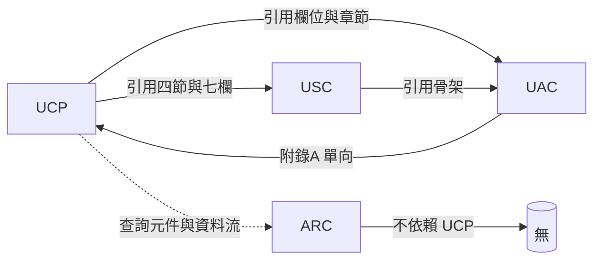

# UGA 三層契約與架構責任重構評估

- 文件狀態：PROPOSED
- 範圍：局部重構，保留原版本，不推倒重寫，不升格 Canonical

## 一、差異分析

| 位置 | 重構前 | 重構後 | 解決的問題 |
|---|---|---|---|
| UCP A03 | 逐章列出必填欄位，等於重抄 UAC | 只鎖定契約版本與雜湊，欄位以引用位置表示 | 欄位定義重複 |
| UCP A04 | 流程與章節雙向對應，系統流程也納入 | 製作流程與系統流程分離，對應只對文件章節 | 循環依賴 |
| UCP A05 | 章節編號與契約一致（隱含 UCP 命名章節） | 章節標題與編號以 UAC 或 USC 為唯一來源 | 命名權重疊 |
| UCP A06 | AC 可判定、有測題 | 只做任務級實例化，流程 AC 只驗執行與證據，內容判定引用契約 AC ID | 判定標準重複 |
| UAC 第 5、6、7 章 | 只有欄位清單 | 各加責任邊界，明示為系統流程、元件介面、資料流的唯一權威 | 結構權威不明 |
| UAC 附錄 A | 章節與步驟互相對應 | 改為單向，章節指出產生步驟，不要求步驟被章節承接 | 循環依賴 |
| USC 第 5 節 | 只說引用 UAC | 補明引用只取骨架與欄位名，不得把文件架構寫入 Skill 本體 | 邊界模糊 |
| A12 | 獨立驗收、逐條判定 | 不變，保留 | 無 |

## 二、責任矩陣

| 維度 | 定義者 | 執行者 | 驗證者 | 唯一權威檔案 |
|---|---|---|---|---|
| 執行 | UCP | 製作 AI | A12 獨立驗收者 | ucp-spec.md |
| 結構 | 架構書 | 架構書撰寫者 | R-DESIGN 與 R-AUD | architecture/uga-architecture.md |
| 產物契約 | UAC | UCP A03 引用 | 文件檢查器 | uac-spec.md |
| Skill 契約 | USC | skill_lint | R-DESIGN | usc-spec.md |
| 紀錄 | 帳本規格 | ledger.py | R-EVD | ledger-spec.md |

## 三、依賴關係圖

重構前是 UCP → UAC 第 5 章 → 附錄 A → UCP 的環；重構後附錄 A 只保留單向箭頭，環消失。

## 四、最小修改方案

只改七個位置：UCP 的 A03、A04、A05、A06，UAC 的第 5、6、7 章與附錄 A，USC 第 5 節；新增一份架構書候選。其餘條文、編號、授權、Owner、Writer 一律不動。

## 五、受影響 AC

| AC | 變化 |
|---|---|
| AC-A03-01 | 改為驗契約版本鎖定與未重抄 |
| AC-A04-04 | 新增，驗對應表不含系統流程 |
| AC-A06-04 | 新增，驗流程 AC 未複製契約判定 |
| AC-A12-01～06 | 不變 |
| 總數 | 53 → 55 條 |

## 六、回歸與回復

回歸：十二個檢查器 PASS，二十二題負向回歸 PASS，新增 R-22 驗附錄 A 單向規則會被攔截。回復方式：v0.6.2 原樣保留，回退只需切回 `candidate-v0.6.2`，diff 見 `diff/v0.6.2_to_v0.8.7.patch`。

## 七、未確認事項（UNKNOWN）

架構書是否取代 UAC 第 5 至 7 章、還是兩者並存而 UAC 只留格式；命名原則是否列為正式決策；miko-core 改寫後是否保留四段與對齊行。
